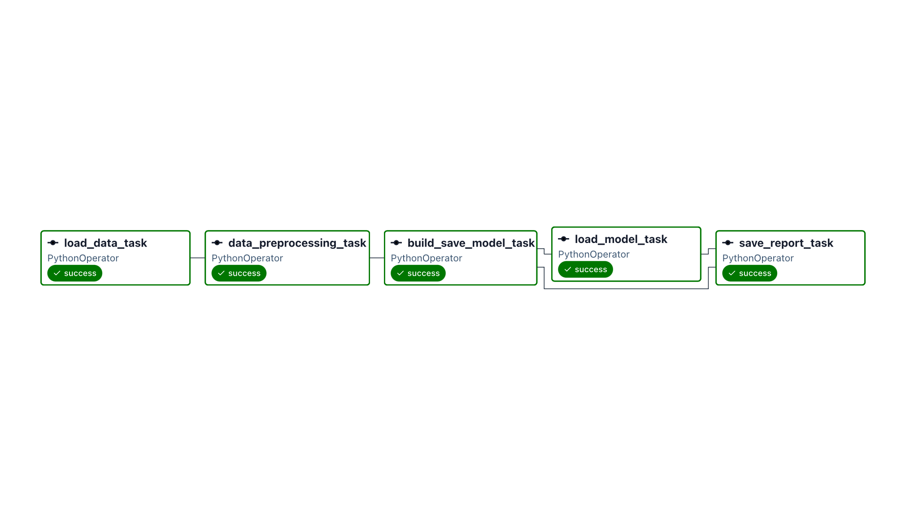

# Airflow Lab 1 – Penguin Clustering

Modified version of [Airflow Lab 1](https://github.com/raminmohammadi/MLOps/tree/main/Labs/Airflow_Labs/Lab_1) from Prof. Ramin Mohammadi's MLOps course.

## What I changed

1. **New dataset:** Palmer Penguins ([seaborn-data](https://github.com/mwaskom/seaborn-data)) instead of credit-card data. The pipeline clusters penguins by `bill_length_mm`, `flipper_length_mm` and `body_mass_g`.
2. **New task:** `save_report_task` saves a summary of each run to `dags/reports/report.json`.

## Pipeline

```
load_data_task → data_preprocessing_task → build_save_model_task → load_model_task → save_report_task
```



## Result

The elbow method chose **5 clusters** (the original credit-card data gave 8). The penguin data has 3 real species, which shows that the elbow method is a rule of thumb, not an exact answer.

## How to run

```bash
echo "AIRFLOW_UID=$(id -u)" > .env
docker compose up airflow-init
docker compose up -d
```

Open http://localhost:8080 (login `airflow` / `airflow`) and trigger `Airflow_Lab1`. Runs on Airflow 3.3.2 in Docker.
