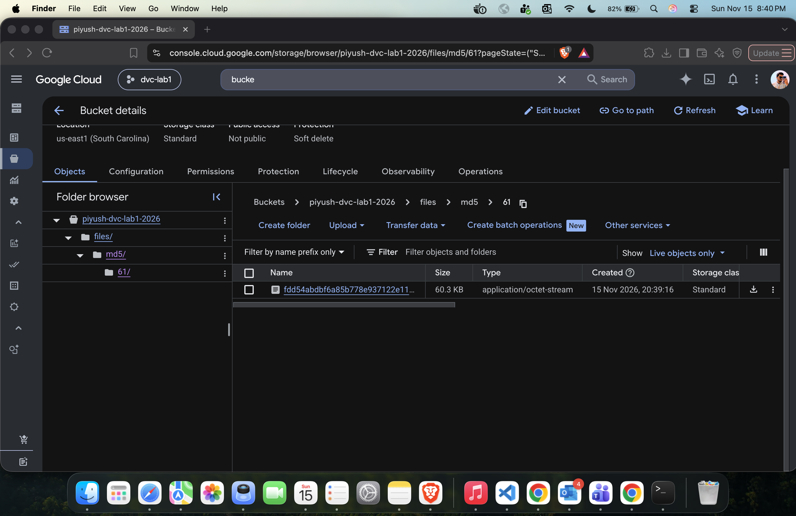
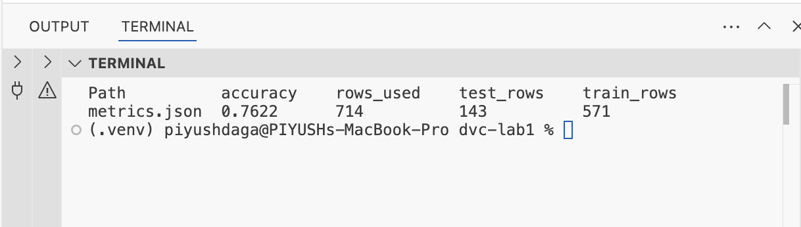
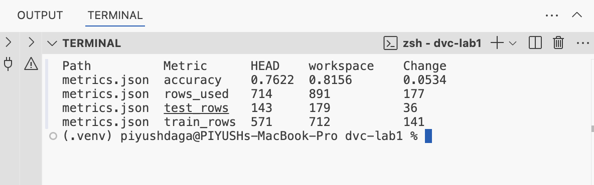
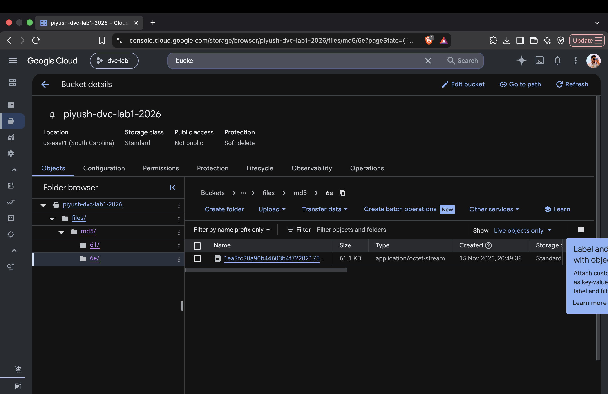
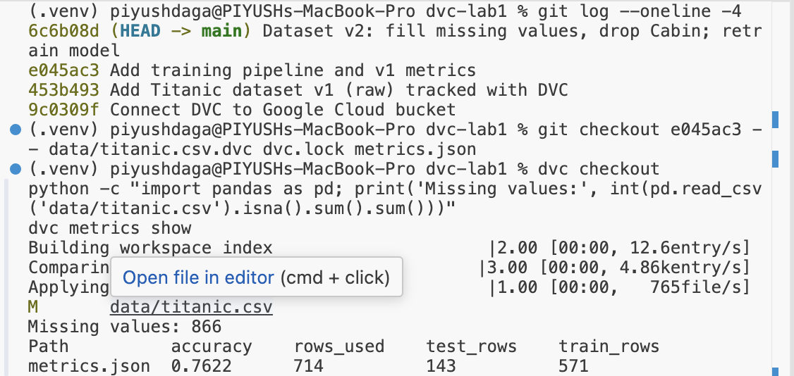
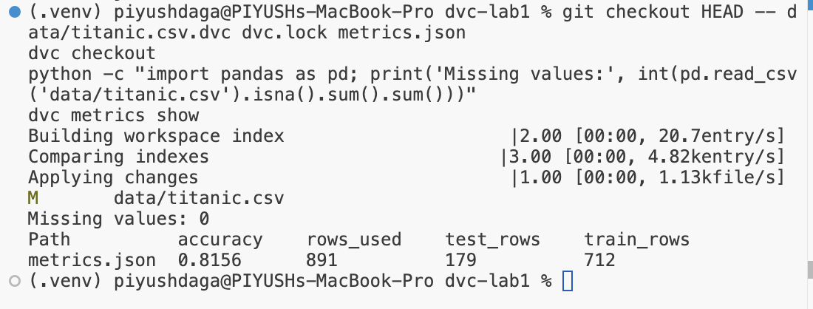
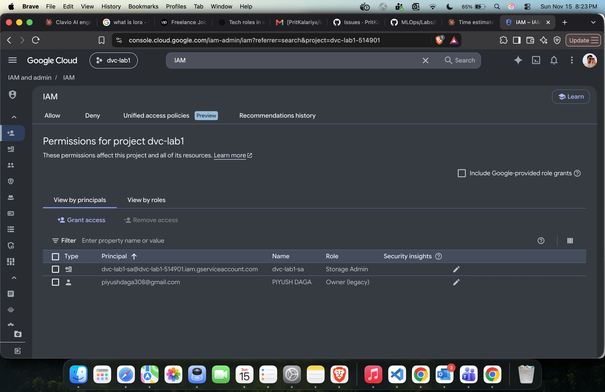

# DVC Lab 1 — Data Versioning with DVC and Google Cloud Storage

This lab tracks two versions of the Titanic passenger dataset with [DVC](https://dvc.org/), using a Google Cloud Storage bucket (`piyush-dvc-lab1-2026`, region `us-east1`) as the remote where the actual data files are stored. Git keeps only a small pointer file for the data, so the repository stays light while every version of the CSV stays available in the cloud. A small training pipeline runs on whichever version is currently checked out, so you can see exactly how a change in the data changes model accuracy.

Original lab: [raminmohammadi/MLOps — Data_Labs/DVC_Labs/Lab_1](https://github.com/raminmohammadi/MLOps/tree/main/Labs/Data_Labs/DVC_Labs/Lab_1)

---

## 1. Changes from the original lab

| Original lab | This submission |
| --- | --- |
| Credit card data (`CC_GENERAL.csv`) | Titanic passenger dataset |
| Version 2 made by replacing the file by hand | Version 2 made by a script, `src/clean_data.py` |
| No model, no metrics | DVC pipeline trains a model and records accuracy |
| Service account with the **Owner** role | Service account with the **Storage Admin** role |
| `dvc init` | `dvc init --subdir` |

**Different dataset.** The Titanic dataset is used instead of the credit card data. It has real missing values in three columns, which makes the "clean the data and see what happens" part of the lab concrete.

**Version 2 is made by a script, not by hand.** The original lab asks you to edit or swap the CSV manually to create a second version. Here `src/clean_data.py` does it, so the change is repeatable and anyone can see exactly what was done:

- fills missing `Age` values with the median age,
- fills the 2 missing `Embarked` values with the most common port,
- drops the `Cabin` column, since most of its values are missing.

**A DVC pipeline that measures the effect.** `dvc.yaml` defines one stage that runs `src/train.py`, which trains a RandomForest classifier and writes `metrics.json`. Because the stage depends on `data/titanic.csv`, DVC knows the model has to be retrained whenever the data version changes, and `dvc metrics diff` compares the accuracy of one version against another. Without this, the lab shows that the data changed but not whether the change was an improvement.

**Safer Google Cloud setup.** Three differences from the original instructions:

- the service account has the **Storage Admin** role rather than **Owner**, so the key can only touch storage and nothing else in the project;
- the key file is kept **outside the repository**, so it cannot be committed by accident;
- the path to the key is saved with `dvc remote modify --local`, which writes it to `.dvc/config.local` — a file Git ignores — instead of the shared `.dvc/config`.

This also replaces the original lab's credentials command, which passed a `--lab2` flag that DVC does not accept.

**Set up as a sub-directory project.** This lab lives inside a repository that holds other labs, so DVC was initialised with `dvc init --subdir`. That keeps the `.dvc` directory and the pipeline scoped to this folder. For the same reason, switching back to an older data version restores only this lab's three tracked files rather than checking out the whole repository at an old commit.

---

## 2. Project structure

```
dvc-lab1/
├── .dvc/
│   ├── config              # remote name and bucket URL (committed)
│   └── config.local        # path to the service account key (ignored by Git)
├── .dvcignore
├── .gitignore
├── data/
│   ├── .gitignore          # written by DVC, keeps titanic.csv out of Git
│   ├── titanic.csv         # the real data (not in Git; stored by DVC)
│   └── titanic.csv.dvc     # pointer file: md5 fingerprint + size
├── src/
│   ├── clean_data.py       # turns version 1 into version 2
│   └── train.py            # trains the model, writes metrics.json
├── screenshots/            # evidence for this submission
├── dvc.yaml                # the pipeline definition (one 'train' stage)
├── dvc.lock                # what the last pipeline run actually used
├── metrics.json            # accuracy and row counts of the latest run
├── requirements.txt
└── README.md
```

---

## 3. Steps performed

### Setup

```bash
python3 -m venv .venv
source .venv/bin/activate
pip install -r requirements.txt

dvc init --subdir
```

`--subdir` tells DVC that this folder is its own DVC project even though the Git repository starts higher up.

### Connecting the Google Cloud bucket

```bash
dvc remote add -d myremote gs://piyush-dvc-lab1-2026
dvc remote modify --local myremote credentialpath <path-to-key.json>
```

The first command names the bucket and makes it the default remote; it is saved in `.dvc/config` and committed. The second command records where the service account key lives. Because of `--local`, it goes into `.dvc/config.local`, which Git ignores — so the key's location never leaves the machine, and the key file itself is stored outside the repository.

### Version 1 — the raw data

```bash
curl -o data/titanic.csv https://raw.githubusercontent.com/datasciencedojo/datasets/master/titanic.csv

dvc add data/titanic.csv
git add data/titanic.csv.dvc data/.gitignore
git commit -m "Add Titanic dataset v1 (raw) tracked with DVC"
dvc push
```

`dvc add` replaces the file in Git's eyes with a small pointer file, `data/titanic.csv.dvc`, holding the file's md5 fingerprint and size. `dvc push` uploads the real file to the bucket.

### The training pipeline

```bash
dvc stage add -n train \
  -d src/train.py -d data/titanic.csv \
  -M metrics.json \
  python src/train.py

dvc repro
dvc metrics show
```

`dvc stage add` writes the stage into `dvc.yaml`: what to run, what it depends on, and what it produces. `dvc repro` runs it and records the result in `dvc.lock`. `dvc metrics show` prints the contents of `metrics.json`.

### Version 2 — the cleaned data

```bash
python src/clean_data.py

dvc add data/titanic.csv
dvc repro
dvc metrics diff

git add data/titanic.csv.dvc dvc.lock metrics.json
git commit -m "Dataset v2: fill missing values, drop Cabin; retrain model"
dvc push
```

The script overwrites `data/titanic.csv` with the cleaned data. `dvc add` records the new fingerprint, `dvc repro` retrains on the new data, and `dvc metrics diff` compares the new accuracy against the committed one.

### Switching between versions

Go back to version 1:

```bash
git checkout <v1-commit> -- data/titanic.csv.dvc dvc.lock metrics.json
dvc checkout
```

Return to version 2:

```bash
git checkout HEAD -- data/titanic.csv.dvc dvc.lock metrics.json
dvc checkout
```

`git checkout` restores the three small tracked files — the data pointer, the pipeline lock file, and the metrics. `dvc checkout` then reads the pointer and puts the matching version of `data/titanic.csv` back in place, pulling it from the local cache or the bucket. In this repository the version 1 commit was `e045ac3` ("Add training pipeline and v1 metrics").

---

## 4. Results

|  | Version 1 (raw) | Version 2 (cleaned) |
| --- | --- | --- |
| Missing values | 866 | 0 |
| Rows used for training | 714 | 891 |
| Train / test rows | 571 / 143 | 712 / 179 |
| Accuracy | 0.7622 | 0.8156 |

`src/train.py` drops any row with a missing value in the columns it uses, so on the raw data the 177 passengers with no recorded age were thrown away before training. Filling those ages with the median keeps all 891 passengers, and accuracy rose by 0.0534.

One honest caveat: because the two versions have different numbers of rows, the 20% held back for testing is also a different size (143 rows versus 179 rows). The two accuracy numbers are therefore measured on different test sets, so this is a good indication that cleaning helped rather than an exact, like-for-like measurement.

**How the versions are stored in the bucket.** DVC names each stored file after its md5 fingerprint — a short code computed from the file's contents — and files it under the first two characters of that code. Change one byte and the fingerprint changes, so each version becomes a separate object that never overwrites the other:

| Version | md5 fingerprint | Location in the bucket |
| --- | --- | --- |
| 1 (raw) | `61fdd54abdbf6a85b778e937122e1194` | `files/md5/61/fdd54abdbf6a85b778e937122e1194` |
| 2 (cleaned) | `6e1ea3fc30a90b44603b4f7220217500` | `files/md5/6e/1ea3fc30a90b44603b4f7220217500` |

The fingerprint of whichever version is currently checked out is the one written in `data/titanic.csv.dvc`.

---

## 5. Screenshots


*Version 1 in the bucket `piyush-dvc-lab1-2026` (us-east1), stored under `files/md5/61/` as a 60.3 KB object named after its fingerprint.*


*`dvc metrics show` after training on the raw data: accuracy 0.7622, 714 rows used, 571 train / 143 test.*


*`dvc metrics diff` comparing the committed version 1 (HEAD) with the cleaned version 2 (workspace): accuracy up 0.0534, 177 more rows used.*


*The same bucket after pushing version 2: a second folder `files/md5/6e/` now holds the cleaned 61.1 KB file, next to version 1 in `61/`.*


*Going back to version 1 with `git checkout <v1-commit> -- …` followed by `dvc checkout`: the missing values return to 866 and accuracy to 0.7622.*


*Returning to version 2 with `git checkout HEAD -- …` and `dvc checkout`: missing values back to 0 and accuracy back to 0.8156.*


*The project's IAM page: the service account used by DVC holds the Storage Admin role rather than Owner.*

---

## 6. How to reproduce

1. **Clone the repository and open this folder.**

   ```bash
   git clone <repo-url>
   cd MLOps-Labs/Data_Labs/dvc-lab1
   ```

2. **Create the environment and install the packages.**

   ```bash
   python3 -m venv .venv
   source .venv/bin/activate
   pip install -r requirements.txt
   ```

3. **Point DVC at your own bucket and key.** The bucket in `.dvc/config` is private, so use one of your own. Create a service account with the Storage Admin role, download its JSON key, and keep the key file somewhere outside the repository.

   ```bash
   dvc remote modify myremote url gs://<your-bucket>
   dvc remote modify --local myremote credentialpath <path-to-key.json>
   ```

4. **Get the data and run version 1.**

   ```bash
   curl -o data/titanic.csv https://raw.githubusercontent.com/datasciencedojo/datasets/master/titanic.csv
   dvc add data/titanic.csv
   dvc repro
   dvc metrics show
   dvc push
   ```

   Commit `data/titanic.csv.dvc`, `data/.gitignore`, `dvc.yaml`, `dvc.lock` and `metrics.json` at this point, so there is a version 1 commit to return to later.

5. **Create version 2 and compare.**

   ```bash
   python src/clean_data.py
   dvc add data/titanic.csv
   dvc repro
   dvc metrics diff
   dvc push
   ```

   Commit the updated `data/titanic.csv.dvc`, `dvc.lock` and `metrics.json`.

6. **Switch between versions** using the two `git checkout` + `dvc checkout` pairs shown in section 3.

> **Never commit the key file.** The service account JSON key gives write access to your bucket. Keep it outside the repository, set its path only with `dvc remote modify --local` (which writes to the Git-ignored `.dvc/config.local`), and never add it to a commit. If a key is ever committed or shared, delete it in the Google Cloud console and create a new one.
